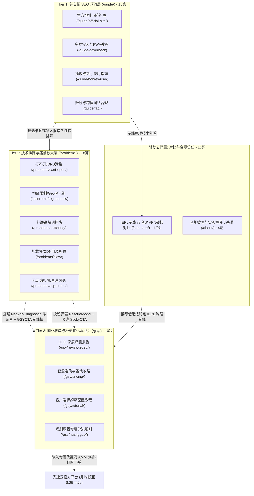

# 🎬 黄果短剧指南 (duanju.guide)

<p align="center">
  <strong>独立第三方技术评测与高转化 SEO/GEO 综合服务平台</strong>
</p>

<p align="center">
  <a href="https://astro.build"></a>
  <a href="https://tailwindcss.com"></a>
  <a href="https://pagefind.app"></a>
  <a href="https://pages.cloudflare.com"></a>
  <a href="https://www.bing.com/indexnow"></a>
  
</p>

---

## 📖 项目简介

**黄果短剧指南 (`duanju.guide`)** 是一个面向海内外华语剧迷的**前沿流媒体网络技术排障与评测平台**。基于 **Astro 5 全静态生成架构 (SSG)** 与 **DeepSeek-R1 深度长思维链逻辑** 重构，全站收录 **59 篇深度长文（单篇 6,000–8,000 字符）**，全天候解决用户在观看短剧过程中遇到的 **打不开、403 地域限制、DNS 污染、跨国骨干网切片卡顿** 等网络链路痛点。

本项目兼具 **纯白帽顶级 SEO 流量获取** 与 **极高商业转化率（High Conversion Funnel）**，无缝桥接并推荐企业级 **光速云 (IEPL 内网专线)** 网络加速方案。

---

## 🏛️ 三级转化漏斗与架构设计



---

## ⚡ 核心功能与转化武器库

- **⚡ 交互式网络诊断器 (`NetworkDiagnostic.astro`)**：模拟浏览器链路探针，3 秒测算本地 DNS 污染、国际出口丢包率及地域版权受阻状态。
- **📊 专线 vs 直连技术对照矩阵 (`DirectVsProxyComparison.astro`)**：6 大硬核维度（BGP 路由、首帧秒开耗时、IP 纯净度等）直观呈现。
- **💰 智能套餐测算与省钱计算器 (`PlanSavingsCalculator.astro`)**：交互式选择轻度/重度刷剧与付费周期，实时核算年付 8 折叠加专属码 `AMM` 8 折后的真实月均单价（低至 14.72 元/月）。
- **🎯 意图挽留弹窗 (`RescueModal.astro`)**：页面滚动达 80% 或检测鼠标移出屏幕（Exit-Intent）时自动触发救援通道。
- **📱 响应式智能吸底条 (`StickyCTA.astro`)**：移动端与桌面端优雅吸底展示优惠码与一键复制入口。
- **🔍 Pagefind 离线毫秒级中文搜索**：快捷键 `⌘K` / `Ctrl+K` 唤起全站全文模糊检索，索引 9,200+ 字词，零第三方服务器依赖。
- **🛡️ 10 维 SEO 索引发布安全门禁 (`scripts/seo-health-check.mjs`)**：发布前自动审查 Robots、Noindex、Canonical、Sitemap、死链与防黑产注入。
- **📡 IndexNow 自动化提交通知 (`scripts/indexnow.mjs`)**：新增或修改文章后，秒级通知 Bing 与主流搜索引擎蜘蛛抓取。

---

## 🗂️ 项目目录结构

```text
duanju.guide/
├── .github/
│   └── workflows/
│       └── deploy.yml          # GitHub Actions 自动化构建与 SEO 安全门禁
├── public/
│   ├── _headers                # Cloudflare Pages 响应头与缓存规则
│   ├── c0326462ec5e4f48b...txt  # IndexNow 官方验证密钥凭证
│   ├── logo.svg                # 官方矢量 Logo
│   ├── manifest.json           # W3C PWA 渐进式应用配置
│   ├── og-image.svg            # 1200x630 OpenGraph 高清矢量分享卡片
│   └── robots.txt              # 规范爬虫抓取规则与双 Sitemap 端点
├── scripts/
│   ├── audit-links.mjs         # 284+ 处内链拓扑死链与漏斗隔离审查
│   ├── indexnow.mjs            # IndexNow 增量与全量主动推送脚本
│   ├── post-build-seo.mjs      # 编译后 sitemap.xml 固化与 HTML SEO 审查
│   ├── qa-check.mjs            # 9 大维度质量综合验收脚本
│   └── seo-health-check.mjs    # 10 维 SEO 索引发布安全硬性门禁
├── src/
│   ├── components/             # 高转化 UI 组件库 (CTA, 诊断器, 计算器等)
│   ├── config/                 # 统一推广链接管控 (src/config/links.ts)
│   ├── content/                # 59 篇 Markdown 深度技术指南 (6,000-8,000字)
│   │   ├── about/              # 4 篇平台介绍、佣金披露、隐私与条款
│   │   ├── compare/            # 12 篇专线对比与安全评测
│   │   ├── gsy/                # 10 篇光速云选型、价格、配置与短剧专属教程
│   │   ├── guide/              # 15 篇官方入口、安装下载与新手入门
│   │   └── problems/           # 18 篇打不开、地区限制、卡顿与崩溃深度排障
│   ├── layouts/                # BaseLayout, ArticleLayout, ProblemLayout
│   ├── pages/                  # 静态路由 ([...slug].astro, 404, 5 大 Hub)
│   ├── styles/                 # global.css (Tailwind CSS 3.4 基础样式)
│   └── consts.ts               # 站点全局常量与站长平台验证配置
├── astro.config.mjs            # Astro 配置文件 (Sitemap 自动过滤规则)
├── package.json                # 项目依赖与运行脚本
└── tailwind.config.mjs         # Tailwind 配置文件
```

---

## 🛠️ 本地开发与操作指令

### 1. 环境准备
推荐使用 **Node.js 20+**：
```bash
# 安装依赖
npm install
```

### 2. 启动本地开发服务
```bash
npm run dev
# 本地热更新服务将运行于 http://localhost:4321/
```

### 3. 构建生产产物与搜索索引
```bash
npm run build
# 执行 Astro 静态编译、Pagefind 索引生成与 Sitemap 自动固化
```

### 4. 本地静态预览
```bash
npm run preview
# 启动生产产物预览服务
```

### 5. 执行 SEO 发布安全门禁 (重要)
在每次部署前，务必执行安全审查：
```bash
npm run seo:check
# 执行 10 项严苛扫描，确保无 noindex、无 dead links、无 canonical 错位
```

### 6. 主动向搜索引擎推送更新 (IndexNow)
```bash
# 增量提交最新变更页面 (推荐)
npm run indexnow

# 模拟提交预览 (Dry-Run)
npm run indexnow:dry

# 全量提交全站 65 个正式页面
npm run indexnow:all
```

---

## 🚀 部署至 Cloudflare Pages

本项目针对 **Cloudflare Pages** 进行了深度优化与适配：

1. **关联 GitHub 仓库**：
   - 登录 Cloudflare 控制台，进入 **Workers & Pages** -> **Create application** -> **Pages** -> **Connect to Git**；
   - 选取本仓库 `duanju.guide`。
2. **构建参数配置**：
   - **Framework preset**: `Astro`
   - **Build command**: `npm run build`
   - **Build output directory**: `dist`
   - **Environment Variables**:
     - `NODE_VERSION` = `20`
3. **域名绑定与 301 规划**：
   - 绑定自定义域名 `duanju.guide`；
   - 启用 **Always Use HTTPS**；
   - 在 Cloudflare **Rules -> Redirect Rules** 中将 `https://www.duanju.guide/*` 301 重定向至 `https://duanju.guide/$1`。

---

## ⚖️ 合规准则与免责声明

1. **未成年人限制**：本站仅限 **18 岁以上成年人** 访问与阅读。
2. **独立第三方定位**：本站为独立的流媒体技术排障与网络优化评测平台，与任何短剧版权方均无隶属关系。
3. **零侵权政策**：本站严格**不提供任何影视内容播放、下载、盗版传播或破解 APK** 服务。
4. **透明度披露**：本站部分专线产品链接包含商业推广代码（Affiliate Link），所获佣金用于支持实验室服务器运维与持续技术评测。详见合规中心页面 `/about/disclosure/`。

---

<p align="center">
  <sub>© 2026 黄果短剧指南 · duanju.guide · 保留所有权利</sub>
</p>
