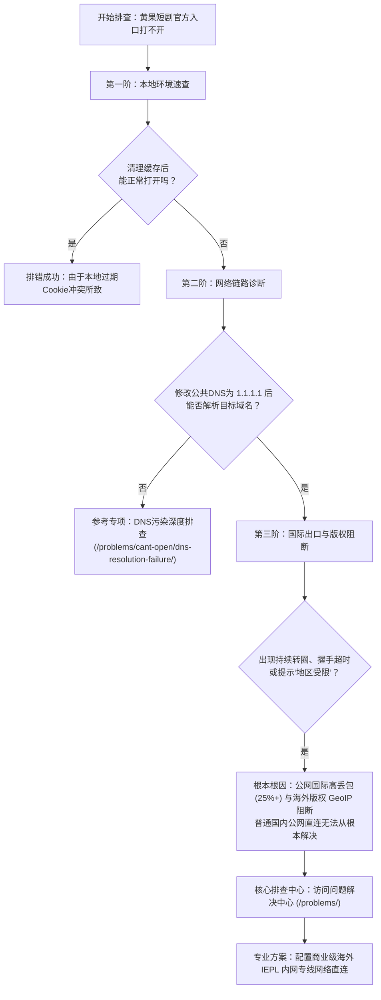

## 导言：2026 短剧视听浪潮与官方入口访问痛点

步入 2026 年，精品微短剧已成为全球流媒体视听领域爆发式增长的核心赛道。快节奏反转、高密度悬念与移动端竖屏沉浸式体验，吸引了海量海内外华人及追剧爱好者的日常驻足。作为行业内备受瞩目的标杆平台之一，**黄果短剧**凭借丰富的内容矩阵与高水准的剧集制作，积累了庞大的高活跃用户群体。

然而，在日常访问过程中，全网各大技术社区与搜索引擎高频出现大量关于官方入口的困惑反馈：
> “昨天还能看的黄果短剧网址，今天怎么突然显示‘连接已重置’？”  
> “搜索出来的黄果短剧入口点进去全是高风险澳门博彩弹窗，到底哪个才是正规官方网页？”  
> “在电脑 Edge 浏览器上打得开，换到手机 5G 网络就一直白屏转圈，这是怎么回事？”

为了彻底解答广大剧友的疑惑，消除山寨镜像与恶意木马给用户设备带来的严重安全威胁，本指南由**黄果短剧网络应急小组**技术专家团队操刀编写。我们将从**互联网底层通信协议（DNS / TLS / CDN / TCP）**的硬核技术视角，深度剖析官方入口的架构原理，拆解假冒钓鱼网站的伪装伪术，并提供一套权威、详尽、可实操的防伪导航与访问排错全景方案。

> **合规免责声明**：本指南为第三方独立技术科普与网络环境自检指引，不提供任何剧集视频播放、在线代充值或破解安装包下载。请在遵守当地法律法规的前提下规范使用网络工具。本站全部技术内容仅限 18 周岁以上成年人查阅。

---

## 一、黄果短剧底层网络架构与全球分发拓扑

很多普通用户往往存在一个认知误区：“既然是一个看剧网站，为什么不能像国内普通资讯站一样，随时随地在任何网络下秒开？”要搞清楚这个问题，首先必须深入理解主流短剧平台的底层服务器部署与内容分发网络（CDN）架构。

```
+-----------------------------------------------------------------------------------+
|                         黄果短剧用户终端与服务器通信架构拓扑图                      |
+-----------------------------------------------------------------------------------+
   [ 国内用户终端 ] (手机 / PC / 平板)
          │
          ▼  (1. 本地递归 DNS 解析)
   [ 运营商本地宽带 / 5G 基站 ] (电信 163 / 联通 169 / 移动 CMNet)
          │
          ├───► ⚠️ 潜在阻断点 1：本地运营商 DNS 污染 (返回 127.0.0.1 或空包)
          ▼
   [ 国际骨干出口网关 (International Gateway) ]
          │
          ├───► ⚠️ 潜在阻断点 2：晚高峰公网出口带宽拥塞 (TCP 丢包率 25%~35%)
          ├───► ⚠️ 潜在阻断点 3：TLS Client Hello 阶段 SNI 深度包检测重置 (RST)
          ▼
   [ 海外边缘 Anycast CDN 节点 ] (香港 / 新加坡 / 日本 / 美西 PoP 节点)
          │
          ├───► ⚠️ 潜在阻断点 4：WAF 规则与 GeoIP 地域版权防火墙拦截 (403 Forbidden)
          ▼
   [ 黄果短剧流媒体源站集群 ] (HLS 索引 m3u8 切片 / ts 视频分发服务器 / 鉴权 API)
+-----------------------------------------------------------------------------------+
```

### 1.1 为什么主流短剧平台选择海外 CDN 与分布式集群？

在商业微短剧出海与全球版权运营的大背景下，黄果短剧等平台通常将核心业务数据库、多媒体转码集群与 HLS（HTTP Live Streaming）切片存储部署在亚太乃至全球的高等级云数据中心（如中国香港、新加坡、东京及美西）。

这种架构为平台带来了跨区域容灾、弹性扩展以及面向全球华人的高吞吐优势，但对于身处中国大陆境内的终端访问者而言，却直接带来了跨国链路的天然屏障：
1. **多跳网络中继带来的物理延迟（RTT）累积**：数据包从用户手机发出，需经过本地城域网、省级骨干网、国家级国际互联出口，再跨越数千公里的海底光缆到达海外机房。若直连链路发生丢包，一次简单的 TCP 握手重传就会耗费数百毫秒。
2. **CDN Anycast 调度失效**：平台部署了全球 Anycast CDN。然而国内本地运营商 DNS 往往会将请求误调度至欧美长距离节点，导致首屏网页加载异常迟缓，甚至直接触发超时断开。

### 1.2 HLS 流媒体切片与动态带宽自适应

短剧与传统长视频（如时长 2 小时的电影）在传输机制上存在本质不同。短剧单集时长通常在 60 秒至 120 秒之间，平台前端播放器普遍采用基于 HTTP 的 **m3u8 播放列表 + ts / m4s 短微切片** 架构。

在正常通信状态下，播放器每次拉取一个时长仅为 2~4 秒的视频微切片。这种模式虽然极利于快进和切集，但对**网络瞬时抖动（Jitter）与连续往返丢包**极为敏感。一旦公网链路发生大于 3% 的微小丢包，TCP 拥塞控制算法（如 Cubic 或 BBR）便会强制收缩发送窗口，造成播放器缓存队列瞬间归零，直接在屏幕中央呈现出令人焦虑的死锁转圈。

更多关于网络抖动对短剧切片加载影响的深度量化指标，读者可延伸参阅我们的专项技术报告《[黄果短剧基础网络环境要求：带宽、丢包率与网络延迟标准](/guide/faq/network-requirements-guide/)》。

---

## 二、2026 官方正规入口全景导航与安全识别准则

面对纷繁复杂的互联网环境，准确辨识正规官方入口是保障个人设备安全与良好观影体验的第一道防线。下表系统对比了正规官方网站与各类仿冒钓鱼站点的特征维度：

### 2.1 正规官网 vs 山寨钓鱼站核心维度横向对比

| 鉴别维度 | 正规官方网页版 (duanju 官方体系) | 山寨仿冒站 / 钓鱼镜像站 | 风险评估与技术机理 |
| :--- | :--- | :--- | :--- |
| **TLS/SSL 证书** | **权威机构 OV/DV 证书**（颁发者多为 Cloudflare Inc ECC CA-3、Let's Encrypt 或 DigiCert） | 伪造自签名证书、证书过期或颁发给无关域名的通配符泛域名 | 钓鱼站无法获取官方同名私钥，常使用廉价自签名证书，浏览器直接提示“您的连接不是私密连接” |
| **页面广告行为** | **界面纯净**，仅有平台自身剧集海报、剧情标签与正规 VIP 机制 | **极度流氓**，首屏强制全屏遮罩、诱导点击博彩、棋牌、假借“中奖”弹窗 | 恶意镜像站的主要盈利模式即为向境外黑灰产导流，点击任意区域均会拉起流氓劫持页面 |
| **安装包与插件要求** | 支持**纯网页端即点即播**，或引导跳转官方正规应用商店 | **强制诱导下载不明 APK**（常提示“必须安装专用播放器才能观看”） | 诱导下载的 APK 绝大多数内置静默窃密木马，详情可查阅《[第三方应用权限最小化审计](/compare/safety/apk-permission-audit/)》 |
| **域名命名结构** | 采用简短语义化品牌主域名或固定的全球多活二级域名（如 `m.`, `h5.`, `api.`） | 采用长串无序字母组合、带有乱码数字前缀、频繁变换主域后缀（如 `.top`, `.xyz`, `.club`） | 钓鱼团伙为躲避搜索引擎算法查封，采用批量注册廉价域名的泛解析站群技术 |
| **登录与用户鉴权** | 遵循标准 OAuth 2.0 协议或手机短信/验证码单点登录，数据传输全流程加密 | 简易表单强制索取账号密码，甚至诱导输入银行卡号、微信支付宝支付密码 | 典型的凭证撞库钓鱼，一旦输入即被黑产脚本记录并转卖，详见《[防撞库与账户安全最佳实践](/compare/safety/account-security-best-practices/)》 |

---

### 2.2 官方网站安全核验四步实操法

在进入任何自称“黄果短剧官方”的网页时，建议技术型用户或注重隐私安全的用户按照以下四个步骤进行安全排查：

#### 第一步：检查地址栏安全锁与证书指纹
点击浏览器地址栏左侧的“小锁”或“调参图标”，查看连接的安全性：
- 确认证书状态为 **“有效”**；
- 检查**通用名称 (Common Name)** 是否与当前主域名完全匹配；
- 检查**连接协议版本**：2026 年现代正规平台均已普及启用 **TLS 1.3** 握手协议，若发现网站仍在使用已被废弃的 TLS 1.0 或存在明文 HTTP 混合内容传输，请立即关闭页面。

#### 第二步：审查页面 DOM 树与外链引用
按下键盘 `F12` 唤出浏览器开发者工具，切换至 **Sources**（源代码）或 **Network**（网络）面板：
- 观察页面静态资源（CSS、JS、海报图片）的加载来源；
- 正规官网的所有脚本文件均来源于平台自建的 CDN 资产域名；
- 若发现页面引入了大量来自诸如 `ad-traffic-analytics-*.xyz` 等可疑域名的外部 JavaScript，说明该页面已被注入广告代码或属于第三方恶意封装镜像。

#### 第三步：使用终端命令行核验权威 DNS 解析结果
在 Windows 系统的 PowerShell 或 macOS 终端中，执行标准的 Anycast 域名反查命令：

```bash
# 查询官方域名的公网 A 记录与 CNAME 别名指向
nslookup -type=CNAME 目标域名

# 或者使用更专业的 dig 工具追踪递归解析链条
dig +trace 目标域名 @8.8.8.8
```

**正常回显特征**：权威解析通常指向大型全球 Anycast CDN 服务商（如 Cloudflare, AWS CloudFront, Akamai 等）的 CNAME 别名节点。若解析 IP 赫然显示为国内某不知名数据中心或家庭宽带动态公网 IP，则 100% 属于山寨抓取站。

#### 第四步：curl 探测 HTTP 状态码与响应头
高级用户可以直接通过终端发送携带现代浏览器的标头请求，查看服务端返回的真实响应：

```bash
curl -Iv https://目标域名 -H "User-Agent: Mozilla/5.0 (Windows NT 10.0; Win64; x64) AppleWebKit/537.36"
```

观察服务端返回的 `HTTP/2 200` 或 `HTTP/3 200` 状态码，检查 `Server` 标头（如 `cloudflare`）与 `Content-Security-Policy`（CSP）安全策略，正规大厂入口均具备严密的内容安全防注入标头。

---

## 三、直连为何必定频频受阻？三大底层阻断机理剖析

许多用户在输入完全合法的官方网址后，依然会遇到“网页打不开”、“连接已重置”或长时间白屏。这绝非偶然，而是国内普通宽带公网直连访问海外特定流媒体业务时必然遭遇的**三大通信关卡**。

### 3.1 关卡一：本地运营商递归 DNS 污染 (DNS Poisoning)

在默认的网络环境下，用户发起域名请求时使用的是由中国电信、中国联通或中国移动本地分配的递归 DNS 服务器（如各省市的 Local DNS）。

当请求的域名包含海外 CDN 调度或敏感业务标识时，本地网络设备在解析阶段可能触发**DNS 缓存投毒或静默拦截**：
- 浏览器收到的不是正确的海外 Anycast 真实 IP，而是被篡改后的虚假 IP（如 `127.0.0.1`、`0.0.0.0` 或位于境内的空路由黑洞）；
- 最终导致浏览器立即报错 `ERR_NAME_NOT_RESOLVED` 或 `DNS_PROBE_FINISHED_NXDOMAIN`。

针对此类故障的本地刷新与协议栈重置操作，读者可深入参考专项指导《[黄果短剧打不开怎么办？DNS污染与域名解析排查指南](/problems/cant-open/dns-resolution-failure/)》与《[网络协议栈一键重置教程](/problems/no-access/network-stack-reset-tutorial/)》。

### 3.2 关卡二：TLS Client Hello 阶段 SNI 握手重置 (TCP RST)

随着现代互联网进入全站 HTTPS 时代，所有应用层数据传输均经过强加密。但在客户端与服务端发起连接的第一步——**TLS 握手阶段**，客户端必须发送一个未加密的明文数据包：`Client Hello`。

该数据包中包含了一个名为 **SNI（Server Name Indication，服务器名称指示）** 的扩展字段，用以告知 CDN 边缘服务器当前请求的具体虚拟主机名。
1. 当国际公网网关检测到 Client Hello 中的特定主机名特征时；
2. 会在几十毫秒内向用户的客户端双向伪造并伪造发送带有 `RST（Reset）` 标志位的 TCP 报文；
3. 客户端操作系统在接收到底层 RST 报文后，会直接强行切断 TCP 连接，浏览器随之报错 `ERR_CONNECTION_RESET`（连接已重置）。

普通用户即便在本地反复刷新页面、重启光猫上百次，也根本无法绕过物理骨干层面的 SNI 识别拦截。

### 3.3 关卡三：海外源站流媒体地域版权风控 (Geo-blocking)

微短剧行业在海外分发时受到严密的知识产权保护法律约束。海外制作方与平台签订的版权协议中明确规定：**版权内容严禁向未经授权的特定国家和地区分发**。

平台边缘服务器接入了全球权威的商业 GeoIP 数据库（如 MaxMind GeoIP2 Precision）：
- 当边缘服务器识别到用户的请求公网出口 IP 属于中国大陆原生 IP 段时；
- 平台应用防火墙（WAF）会直接触发默认拒绝规则，返回 `403 Forbidden` 或返回一个包含特殊 JSON 报错的拦截页面：
  ```json
  {
    "code": 40301,
    "message": "Service Not Available in Your Region. Geographical restriction applied."
  }
  ```
- 此时在前端页面上，用户看到的往往是**界面骨架能出来，但所有剧集封面全部显示加载失败，点击播放按钮持续转圈至超时报错**。

关于地域版权识别算法与规避机理，请详读《[黄果短剧显示“当前地区无法提供服务”深度排错](/problems/region-lock/geoblocking-explained/)》与《[短剧跨国跨境访问版权规则解读](/guide/faq/cross-border-access-regulations/)》。

---

## 四、全终端官方入口访问与防走丢最佳实践

为了保障不同设备下的视听流畅度，我们针对主流操作系统整理了标准化的操作指南。

### 4.1 PC 桌面端（Chrome / Edge / Safari）配置技巧

桌面端拥有更强的硬件解码能力与更宽阔的可视面积，但在高分辨率下对网络下行稳定性的要求更高：
1. **启用独立浏览器纯净配置 Profile**：
   - 避免使用堆积了大量不知名第三方插件的日常浏览器窗口；
   - 建议在 Chrome 中新建一个专用的“短剧视听”用户配置文件，禁用可能干扰网络请求的强力广告拦截插件（某些插件会将平台的正规 m3u8 切片请求误杀拦截）。
2. **正确设置书签与快捷方式**：
   - 确认当前处于官方正规域名下后，按下快捷键 `Ctrl + D`（macOS 为 `Cmd + D`）保存至收藏夹主目录；
   - 不要将重定向后的带有临时动态 Token 的深层播放页 URL 存为书签，而应保存标准的根路径地址。
3. **多端网页访问特性调优**：
   - 详见《[黄果短剧多端网页访问技巧：手机浏览器与电脑端访问差异解析](/guide/official-site/multi-device-access/)》。

### 4.2 移动端（iOS / Android）添加 PWA 桌面轻应用

相比于费尽周折寻找可能随时掉签的第三方封装客户端，利用现代浏览器内置的 **PWA（Progressive Web App，渐进式网页应用）** 技术将官方网页端固定至手机主屏幕，是当前全网公认最稳定、最安全、最抗封锁的“准客户端体验”：

```
+-----------------------------------------------------------------------------------+
|                        PWA 桌面快捷方式安装流转全景步骤                             |
+-----------------------------------------------------------------------------------+
  1. iOS Safari 操作：
     进入官方入口 ──► 点击底部中间【分享】按钮 ──► 下滑选择【添加到主屏幕】 ──► 完成桌面图标固化
  
  2. Android Chrome 操作：
     进入官方入口 ──► 点击右上角【三点菜单】 ──► 点击【安装应用】或【添加到主屏幕】 ──► 桌面独立图标生成
+-----------------------------------------------------------------------------------+
```

- **PWA 的核心优势**：
  - **沉浸式全屏**：启动后自动隐藏浏览器顶部地址栏与底部操作栏，与原生 App 视觉无异；
  - **绝不闪退与掉签**：完全免除企业签名过期或 TestFlight 名额满载的痛点（详见《[iOS客户端企业签名防封教程](/guide/download/ios-installation-steps/)》）；
  - **本地缓存加速**：静态 UI 骨架由 Service Worker 本地持久化缓存，每次启动秒级渲染。
- 完整配置步骤请参考专项实操指南《[黄果短剧桌面轻应用 (PWA) 配置：无需安装客户端畅享全屏体验](/guide/download/pwa-web-app-setup/)》。

---

## 五、遇到打不开或加载异常时的阶梯排查法

当您在直连状态下遭遇官方入口无法响应时，切勿盲目病急乱投医下载网上的所谓“破解加速插件”。请依照以下三阶排障法则有序排查：



### 5.1 第一阶：本地环境速查（排除设备本地死锁）
- **强行刷新缓存**：在 PC 端按下 `Ctrl + F5`，强制跳过本地浏览器 Disk Cache 重新向远端拉取网页；
- **清理本地 DNS 缓存**：
  - 在 Windows 命令提示符中执行 `ipconfig /flushdns`；
  - 在 macOS 终端中执行 `sudo dscacheutil -flushcache; sudo killall -HUP mDNSResponder`；
- **检查防火墙与杀毒软件**：确认系统防护软件未对浏览器的出站 443 端口进行全局过滤。

### 5.2 第二阶：网络链路诊断（定位具体卡顿节点）
若本地配置无误但依然报错，可通过本站提供的交互式检测组件或排障手册，对当前宽带进行运营商级跨网测试：
- 电信网络（AS4134）晚高峰国际出口拥堵排查：《[运营商跨网互联限速与晚高峰丢包分析](/problems/slow/isp-throttling-analysis/)》；
- 视频加载在首帧持续转圈专项排查：《[视频加载一直转圈停在第一帧解决方案](/problems/buffering/video-loading-stuck/)》；
- 出现 1020 / 403 明确拦截代码时的修复技巧：《[错误代码 1020 / 403 / 502 深度排错](/problems/no-access/http-error-codes-guide/)》。

### 5.3 第三阶：确立网络基础设施的决定性前提
经过上述技术排查后，许多有经验的网络工程师和老剧友都会得出一个不可动摇的客观结论：

> **“在当今复杂的国际互联网传输环境下，普通国内宽带直连访问海外部署的流媒体业务，本质上是在用一条充满拥塞、随时可能被重置和丢包的‘颠簸公道’去支撑极高吞吐的‘高频流媒体’。”**

不论是 DNS 污染拦截、TLS 握手 RST 阻断，还是平台源站由于版权风控对国内原生 IP 执行的 GeoIP 封锁，均属于**公网传输路径上的硬性客观障碍**，单靠本地修修补补根本无法获得长久稳定的 1080P 畅爽视听体验。

要从源头根除视频转圈与打不开，广大用户最终都需要建立一套**“通过洁净海外专线中转”**的合规网络环境。关于公网中继与企业级物理专线（IEPL）的架构级性能差异深度横评，读者可查阅我们的硬核分析专稿《[普通加速器 vs 商业专线架构横评：为什么IEPL专线看剧不转圈？](/compare/accel-vs-vpn/iepl-iplc-deep-dive/)》。

若您当前正在面临打不开或卡顿困扰，建议立即前往我们的核心技术枢纽——**[黄果短剧访问故障排查与解决方案中心](/problems/)**，查阅最新的全套专项 GEO 排障指南，通过标准化的专线直连技术方案，一劳永逸恢复秒开观影。

---

## 六、全景常见问题权威释疑 (FAQ)

### Q1：为什么网上有很多自称“黄果短剧网页版”的网站，界面长得几乎一模一样？
**答**：互联网黑灰产团伙常常使用反向代理爬虫技术，对官方网页进行全站镜像克隆。表面上剧集分类和界面一致，但钓鱼团伙在代码底层悄悄植入了广告弹窗劫持脚本或假冒充值通道。若在镜像站中扫码充值，资金会直接流入诈骗团伙腰包，而官方账户不会收到任何金币。请务必依照本文第二章的标准仔细核对证书与主域名。

### Q2：使用手机 5G 流量能打开，为什么切换到家里千兆 Wi-Fi 反而打不开了？
**答**：这是极为典型的运营商出口路由分流差异。手机 5G 基站（如移动 CMI 或联通骨干）与家庭宽带使用的本地 Local DNS 解析库和出口光缆不同。若家庭宽带分配的出口节点正好遭遇骨干网维护或 DNS 投毒，就会发生“手机能看、Wi-Fi打不开”的局部阻断现象。详细排查步骤请参考《[网络高延迟与网络抖动排查指南](/problems/buffering/high-latency-troubleshooting/)》。

### Q3：官方入口是否需要付费注册才能进入浏览？
**答**：通常不需要。正规官方入口均支持用户免注册直接浏览首页目录与热门剧集排行榜，且前 5~15 集均提供公开试看。凡是刚点进首页就强制弹窗要求输入银行卡信息、强制付费才能查看目录的站点，100% 为假冒钓鱼欺诈网站。关于商业模式与资费政策的客观拆解，请参考《[黄果短剧常见问题20问：收费机制与免广告政策释疑](/guide/faq/billing-and-ad-policy/)》。

### Q4：在海外旅游或出差时，使用当地网络访问黄果短剧会有问题吗？
**答**：如果在新加坡、马来西亚、中国香港等官方版权重点运营的海外区域，当地原生住宅宽带通常可直接流畅访问；但如果处于某些未设立 CDN 边缘节点的欧美小众国家，受远距离跨洋传输影响仍可能遭遇高延迟。具体节点延迟实测可参阅《[黄果短剧海外节点选择与延迟评测指南](/problems/region-lock/node-selection-comparison/)》。

### Q5：如何才能永久防走丢，及时获取最新的正规访问地址？
**答**：建议将本指南主站 **`https://duanju.guide`**（黄果短剧指南）直接加入浏览器书签栏。作为完全独立的第三方技术维护团队，我们通过自动化探测探针 7×24 小时监控全球各 CDN 节点与官方域名的连通性健康状况，并在专区中实时更新最新、最纯净的官方指引。
